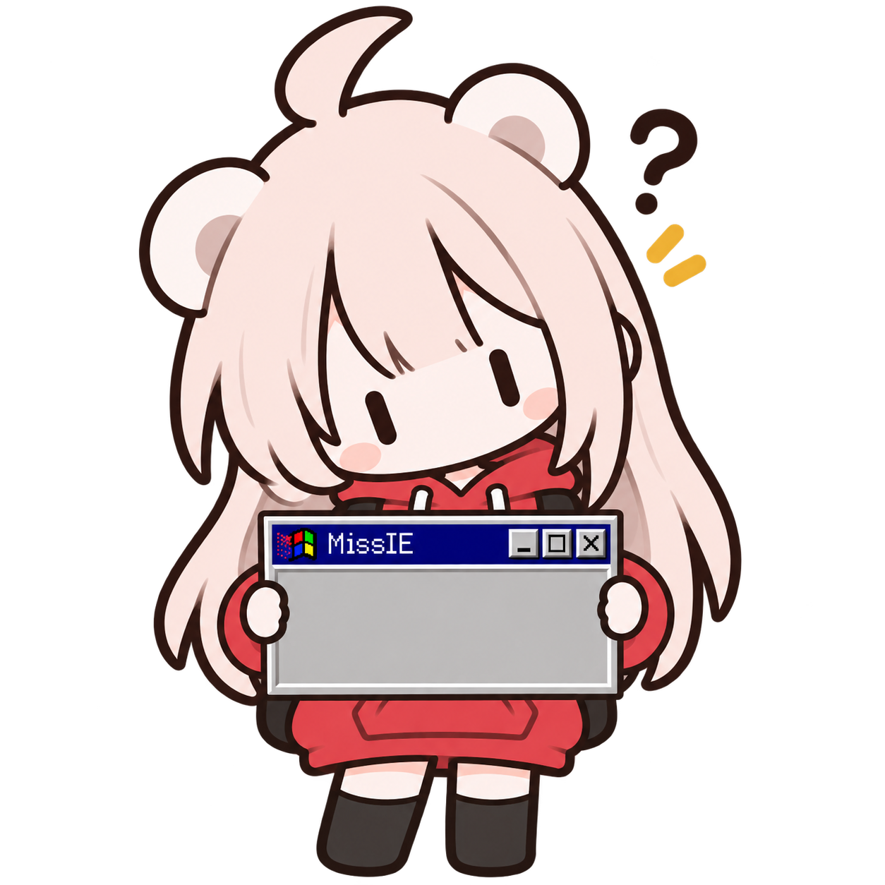
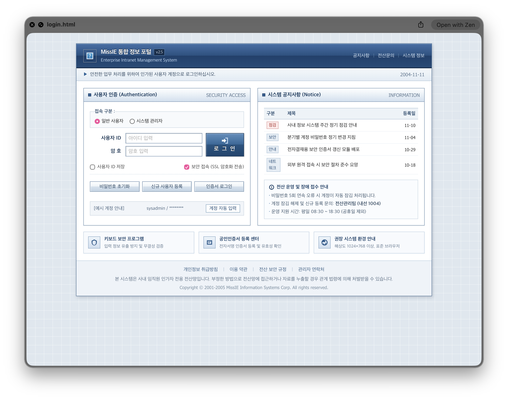
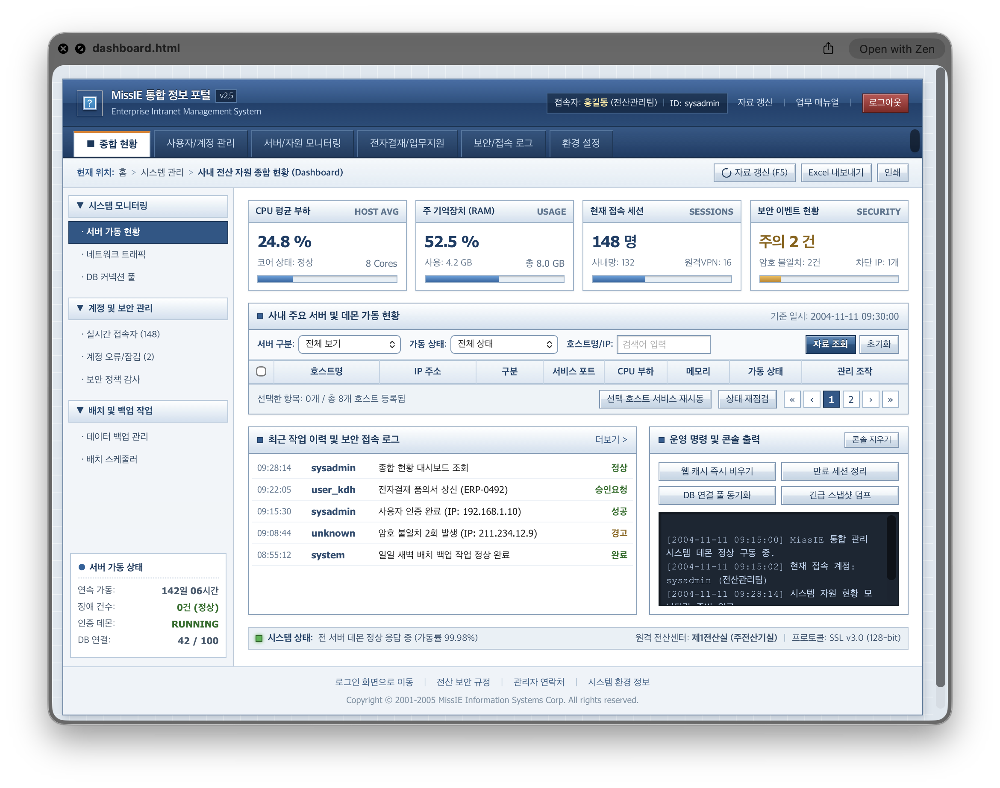

<p align="center">
  
</p>

<h1 align="center">MissIE</h1>

<p align="center">
  <strong>I miss IE.</strong>
</p>

<p align="center">
  <em>최신 기술로 구현하는 구시대적 사용자 경험.</em>
</p>

---

## 이게 뭔가요?

저희는 허구한 날 AI가 만들어 놓은, 하나같이 똑같고 지나치게 모던한 디자인만 보고 살았습니다.

둥글둥글한 카드, 널찍한 여백, 어디서 본 듯한 대시보드. 이제는 질릴 때도 됐습니다.

그래서 준비했습니다. **완전히 새로운 형태의 AI Slop을 만들 시간입니다.**

**MissIE**는 1995~2005년 소프트웨어의 UI/UX를 재현하는 AI 에이전트용 스킬입니다.

현대적인 디자인은 저 구석에 갖다 버리고, Visual C++ 6.0과 씨름하던 2000년대 개발자의 영혼을 빙의해 보세요. 입체적인 단추, 형형색색의 그라데이션, 틀딱 냄새 풀풀 나는 UI/UX를 사용자에게 선사할 수 있습니다.

물론 저희도 생각이란 걸 할 줄 알기 때문에, 실제로 구닥다리 언어나 라이브러리를 사용하지는 않습니다. **기술은 최신으로, 생긴 것만 옛날처럼.** 그게 MissIE의 존재 이유입니다.

## 대충 이런 걸 만듭니다

MissIE를 적용하면 현대적인 프레임워크로도 다음과 같은 화면을 만들 수 있습니다.

| 로그인 화면 | 관리 대시보드 |
|:---:|:---:|
|  |  |

> **생성 환경**
> - 사용 모델: Gemini 3.8 Flash (High)
> - 적용 스킬: MissIE
>
> 위 화면들은 MissIE를 적용한 예시이며, 스킬이 특정 디자인이나 레이아웃을 강제하지는 않습니다. 결과물은 모델과 작업 지시에 따라 달라질 수 있습니다.

## 특징

- **고전적인 UI** — 입체 버튼, 그라데이션, 비트맵 아이콘, 촘촘한 레이아웃
- **구형 웹 디자인** — 2000년대 그룹웨어, 관리자 페이지, 기업용 웹 시스템
- **데스크톱 감성** — Win32, MFC, Windows CE, Java Swing 스타일
- **시스템 문체** — "다시 시도해 보세요" 대신 "다시 시도하십시오"
- **현대적인 구현** — React, Vue, Next.js 등 최신 기술 사용 가능
- **디자인 자유도** — 특정 프로그램의 외형을 복제하지 않고 당시의 디자인 관습을 재현

## 지원 환경

MissIE는 개방형 **Agent Skills** 형식을 기반으로 제작되었습니다.

- OpenAI Codex
- Claude Code
- Google Antigravity
- 기타 Agent Skills 호환 에이전트 그리고 **감자**

## 설치

저장소의 `MissIE` 폴더를 사용하는 에이전트의 스킬 디렉터리에 복사하십시오.

| 에이전트 | 프로젝트별 설치 | 전역 설치 |
|---|---|---|
| Codex | `.agents/skills/MissIE/` | `~/.agents/skills/MissIE/` |
| Claude Code | `.claude/skills/MissIE/` | `~/.claude/skills/MissIE/` |
| Antigravity | `.agents/skills/MissIE/` | `~/.gemini/antigravity/skills/MissIE/` (또는 `~/.gemini/config/skills/MissIE/`) |

터미널에서 바로 설치하려면:

```bash
# 저장소를 클론한 뒤 해당 디렉터리에서 실행:
# Antigravity 전역 설치
mkdir -p ~/.gemini/antigravity/skills && cp -r MissIE ~/.gemini/antigravity/skills/
# Claude Code 전역 설치
mkdir -p ~/.claude/skills && cp -r MissIE ~/.claude/skills/
# Codex 전역 설치
mkdir -p ~/.agents/skills && cp -r MissIE ~/.agents/skills/
```

스킬 디렉터리 구조:

```text
MissIE/
├── SKILL.md
└── references/
    ├── visual-design.md
    ├── desktop-ui.md
    ├── web-ui.md
    └── korean-localization.md
```

## 사용 방법

사용하는 AI 에이전트에서 MissIE 스킬을 호출하거나 작업 지시에 명시하면 됩니다.

**Codex**

```text
$MissIE 개쩌는 00년대 국내 기업용 웹 관리 시스템처럼
보이는 서버 대시보드를 만들어줘. 토큰을 많이 쓰지 마
```

**Claude Code / Antigravity**

```text
/MissIE 00년대 개팔자 아조씨가 만들법한 Windows 유틸리티처럼
보이는 파일 관리 프로그램을 만들어줘.
```

스킬 설명과 작업 내용이 일치하면 에이전트가 자동으로 적용할 수도 있습니다.

## 디자인 철학

**옛날처럼 보인다고 옛날 기술까지 쓸 필요는 없습니다.**

MissIE는 당시 소프트웨어의 디자인과 사용 경험을 재현하는 것이 목적이지, ActiveX나 Internet Explorer 6.0을 부활시키려는 프로젝트는 아닙니다.

보안, 성능, 접근성은 현대적인 기준을 따릅니다.

여러분의 프로그램은 2026년에 개발되었지만, 적어도 겉모습만큼은 2003년에 출시된 것처럼 보일 수 있습니다.

---

<p align="center">
  <strong>MissIE — I miss IE.</strong>
</p>

<p align="center">
  <em>Internet Explorer 6.0 및 800×600 해상도에 최적화되어 있습니다.</em>
</p>

<p align="center">
  <sub>물론 실제로는 아닙니다.</sub>
</p>